# Supplier portal — user flows

The supplier dashboard is the home page after sign-in. From there, a supplier either picks up something in **Needs your attention**, or opens one of four working areas: company information, onboard a product, update an existing product, or publish a Commissioning Store page. Contact and Account management are placeholder pages with no journey yet.

## Sign in

Any supplier portal address sends a signed-out person to sign-in, then back to the page they were opening. A filled-in email and password are enough; this prototype accepts any values.

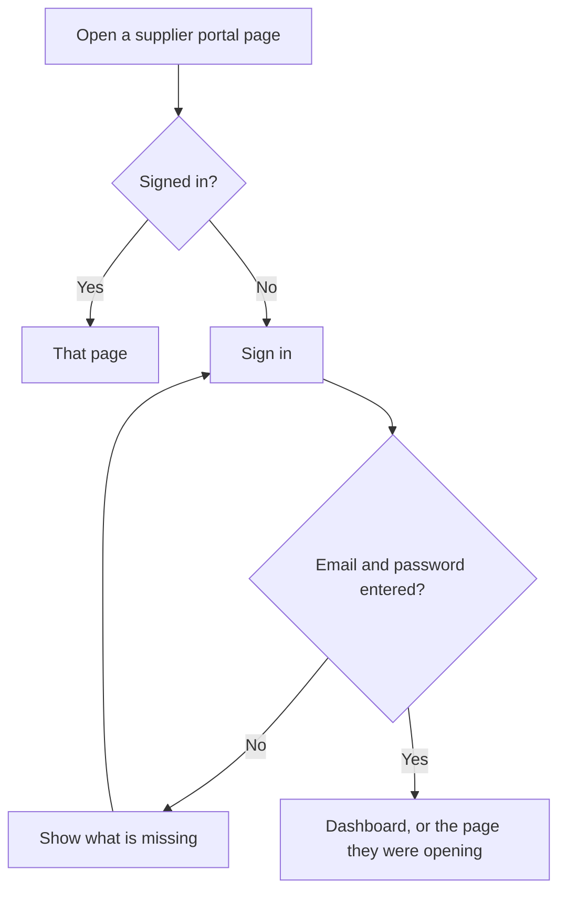

## What the dashboard offers

**Needs your attention** is the work queue. It lists company information that has never been submitted, an onboarding form that is incomplete or needs action, product documents that need action, and a product page or the supplier page that is unpublished or needs action. Draft changes, unpublished changes, and items already in review stay off this list.

The section cards are the longer routes below.

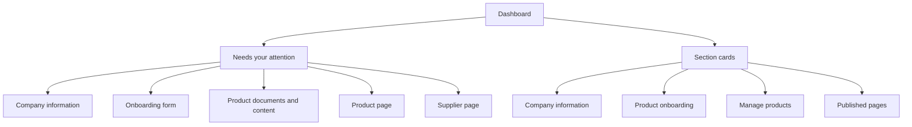

## Company information

Dashboard, then Company information. This is the Section A supplier questionnaire, split into three chapters, each submitted on its own. A chapter that has not been submitted is a row in a task list, marked Incomplete. Opening it runs through its questions one per page (Save and continue), then that chapter's Check your answers and Confirm and submit. Once submitted, the chapter appears on the page as a read-only summary list under its title, with one Change button next to the title. There is no page-level Submit. Once every chapter has been submitted a status and last-updated date are shown on top.

Submitting a chapter applies its answers straight away. There is no HealthStore review for company information.

Chapters and questions (A2 to A4 from the Section A spec are about a product, so they open each product onboarding form instead):

1. Company details: A1 company name; does the company trade under a different name? (added, No / Yes) and, if yes, the trading name; type of organisation (added); A9 country of registration; A10 Companies House, charity number or reference; A8 registered address (NHS Addresses pattern: address lines, town, county, postcode); company website (added)
2. Relationship manager: A5 first name, last name and job title; A6 email and phone number
3. Care Quality Commission: A11 required to register with the CQC? (Yes / No); if yes, A11 date of last assessment and A12 upload of the latest CQC report (file only, no reference name)

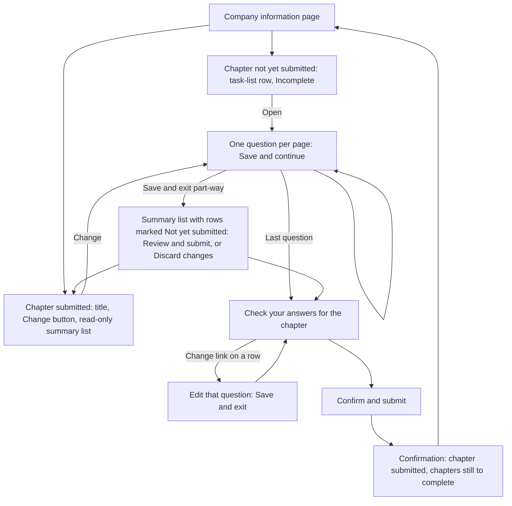

Save and exit on any question keeps the answers as a draft and returns to the Company information page; Cancel and exit discards that page's unsaved edits. Nothing changes until Confirm and submit on the chapter's Check your answers. Submitting one chapter leaves drafts in other chapters as they are.

## Onboard a new product

Dashboard, then Product management, then Product onboarding. Each product has its own form. The sample form is myCOPD. Answers save as you go. Submit stays unavailable until every task is completed.

The form has four sections and seven tasks. Each task is a run of one-question-per-page screens, and some questions only appear depending on earlier answers in the same task (see "Product onboarding question routes" below).

1. Product details (A2 product name, A3 version number, A4 type of product, with a description page when Other)
2. Value proposition (Section B, not scored)
3. Technical questions: Clinical safety (C1), Data protection (C2), Technical security (C3), Interoperability (C4)
4. Key principles for success: Usability and accessibility (Section D)

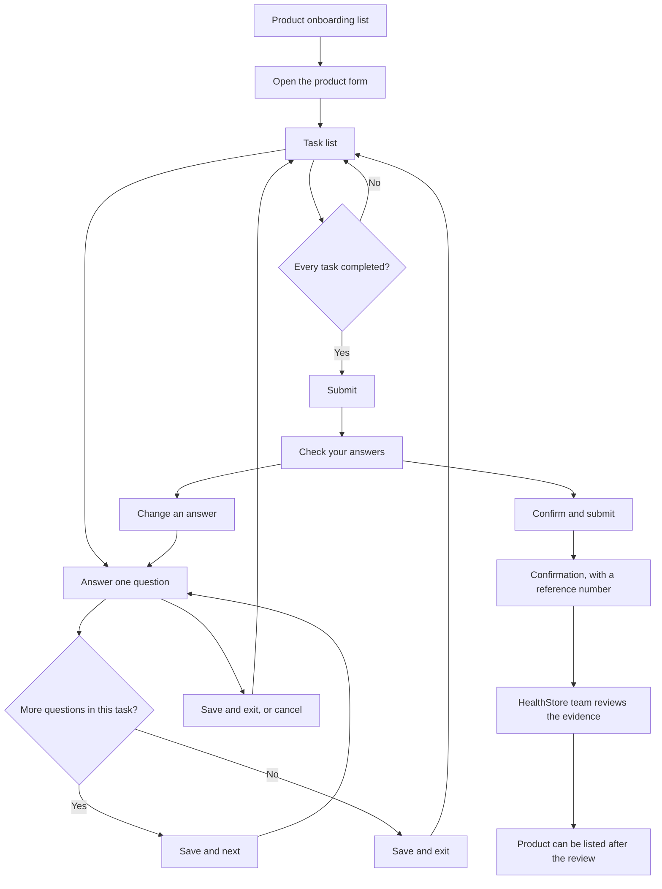

On the last question, Save and exit marks the task completed when the required answers are in. You can leave earlier and come back; the task stays incomplete until then. After submission the form status is Submitted. The product is not listed on the HealthStore until that review is finished. The team says they will be in touch within 10 working days if they need more information.

### Product onboarding question routes

Save and next only visits the questions on the supplier's route. Questions that are skipped are left out of the Completed check and of Check your answers. Changing an earlier answer can bring a skipped question back; its previous answer, if any, is kept. "Provided / Not provided" questions are followed by a separate upload (or text) page when the answer is Provided.

#### Section B: Value proposition

No branching apart from the B4 upload.

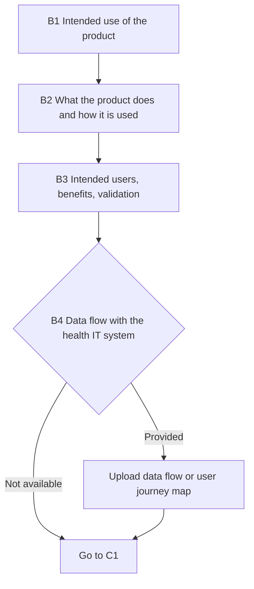

#### C1: Clinical safety (DCB 0129)

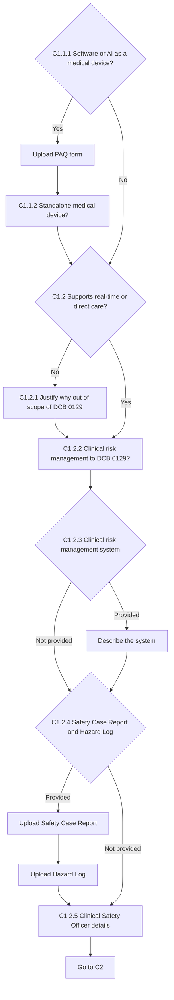

#### C2: Data protection (UK GDPR)

C2.2.1 to C2.2.5 are asked whether or not the product processes personal data.

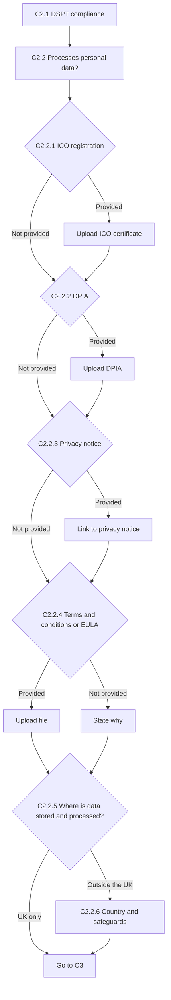

#### C3: Technical security

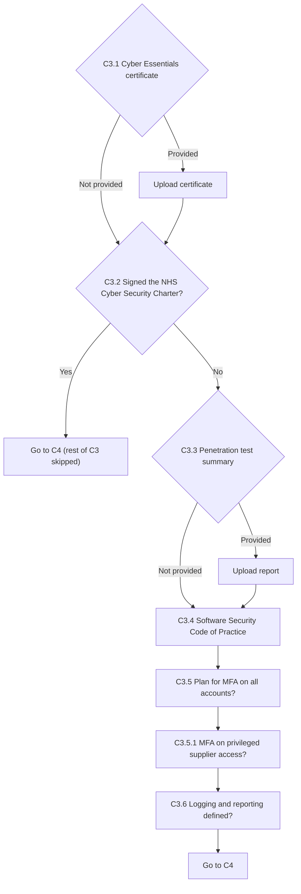

#### C4: Interoperability

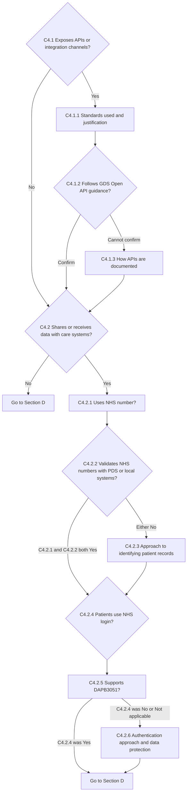

#### Section D: Usability and accessibility

D1.4 asks which platforms the product supports (iOS, Android, Web). A "None of the above" option exists in the model but is hidden for now; if it is switched on and selected, D1.4.1 to D1.5 are skipped.

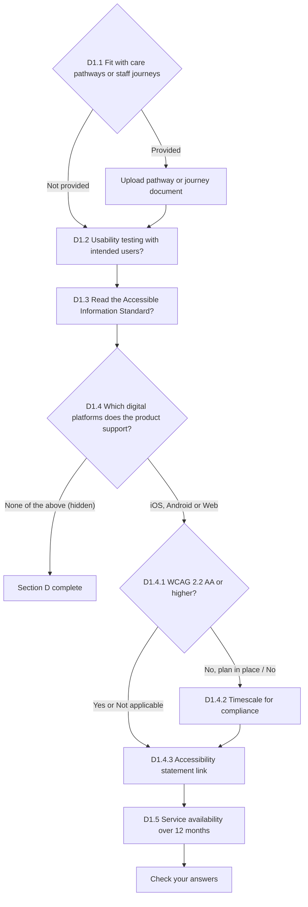

## Update an existing product

Dashboard, then Product management, then Manage products. The sample product is myHeart, which starts as Up to date. A supplier can change the product summary, who it is for, the support email, and the assurance documents.

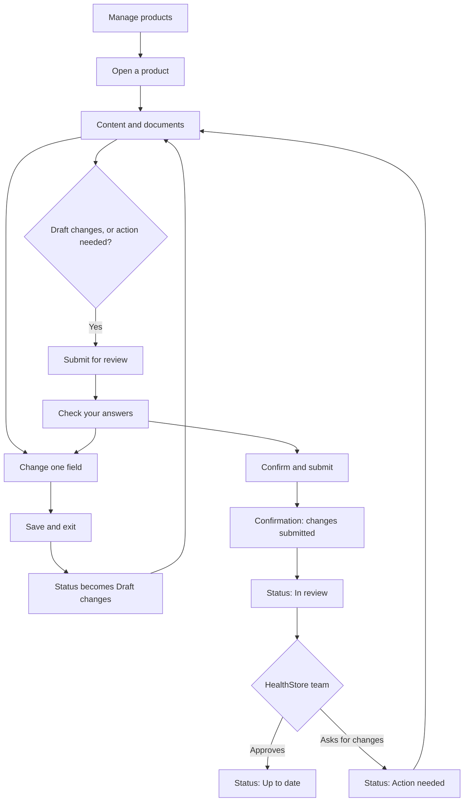

Draft changes are not seen by the HealthStore team. Submit for review only appears once there are draft changes, or the last review came back as action needed. While the status is In review, this prototype can stand in for the team with Simulate approval and Simulate rejection. A rejection puts the submitted values back into the draft so they can be edited and sent again. The dashboard then lists that product under Needs your attention.

## Publish or update a store page

Dashboard, then Published pages. There is a page for each product and one supplier page. The supplier edits the public wording. Content that came from onboarding is shown on the page and cannot be changed here.

There is no separate check-your-answers step. Submit for review sends the page straight to the team and leaves you on the same screen.

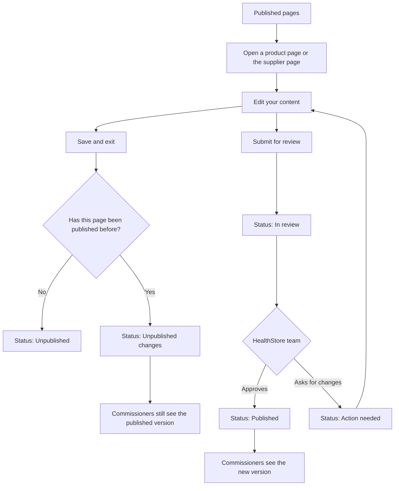

A page that has never been published starts as Unpublished, so commissioners cannot see it. After the first approval it is Published. Later saves become Unpublished changes, and the live page stays as it was until the new version is submitted, reviewed, and approved. A rejected page becomes Action needed and returns to Needs your attention, together with any page that is still unpublished.
