# Supplier portal — user flows

The supplier dashboard is the home page after sign-in. From there, a supplier either picks up something in **Needs your attention**, or opens one of four working areas: company information, onboard a product, update an existing product, or publish a Commissioning Store page. Contact and Account management are placeholder pages with no journey yet.

Everything a supplier submits is accepted straight away. Company chapters apply as soon as they are submitted, an onboarding form is onboarded when it is submitted, product changes become the current version, and store pages are published.

The prototype uses a made-up supplier, **Aurora Health Limited** (contact Brandson Sanderson), with one product, **Respira CBT**, a digital CBT programme for adults with generalised anxiety disorder. Respira CBT is both the sample onboarding form and the sample onboarded product.

## Statuses

| Area | Statuses |
| --- | --- |
| Company information | Incomplete, Draft changes, Up to date |
| Product onboarding | Incomplete, Submitted |
| Manage products | Up to date, Draft changes |
| Published pages | Unpublished, Unpublished changes, Published |

The full list with tag colours is at `/supplier-portal/statuses` (not linked from the dashboard).

## Sign in

Any supplier portal address sends a signed-out person to sign-in, then back to the page they were opening. A filled-in email and password are enough; this prototype accepts any values.

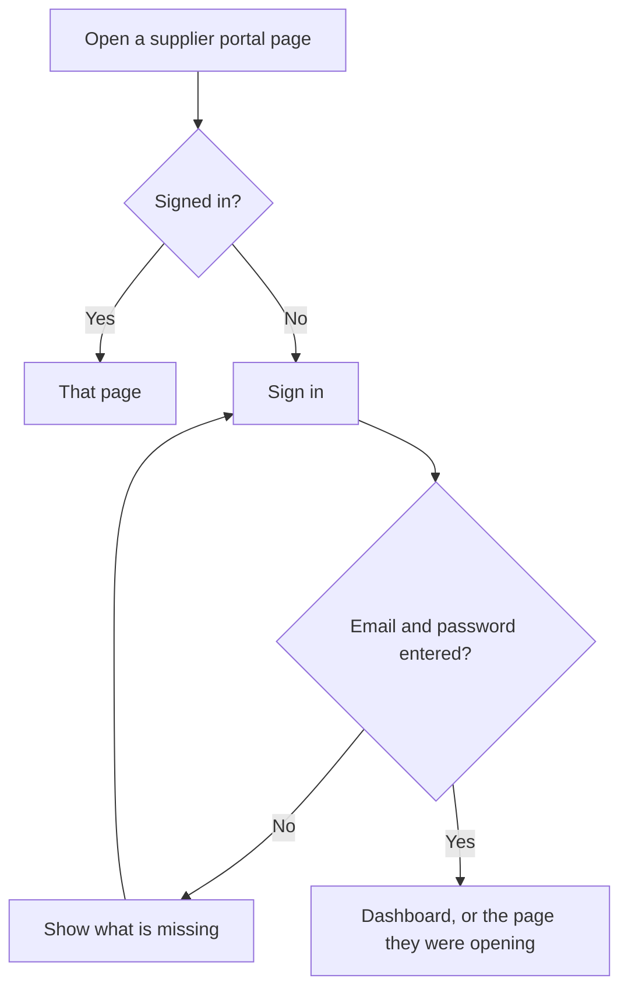

## What the dashboard offers

**Needs your attention** is the work queue. It lists company information that has never been submitted, an onboarding form that is incomplete, and a product page or the supplier page that is still unpublished. Draft changes and unpublished changes stay off this list.

The section cards are the longer routes below.

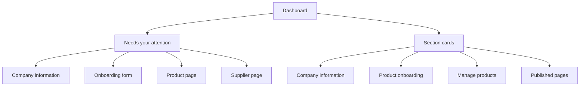

## Company information

Dashboard, then Company information. This is the Section A supplier questionnaire, split into three chapters, each submitted on its own. A chapter that has not been submitted is a row in a task list, marked Incomplete. Opening it runs through its questions one per page (Save and continue), then that chapter's Check your answers and Confirm and submit. Once submitted, the chapter appears on the page as a read-only summary list under its title, with one Change button next to the title. There is no page-level Submit. Once every chapter has been submitted a status and last-updated date are shown on top.

Submitting a chapter applies its answers straight away.

Chapters and questions (A2 to A4 from the Section A spec are about a product, so they open each product onboarding form instead):

1. Company details: A1 company name; does the company trade under a different name? (added, No / Yes) and, if yes, the trading name; type of organisation (added); A9 country of registration; A10 Companies House, charity number or reference; A8 registered address (NHS Addresses pattern: address lines, town, county, postcode); company website (added)
2. Relationship manager: A5 first name, last name and job title; A6 email and phone number
3. Care Quality Commission: A11 required to register with the CQC? (Yes / No); if yes, A11 date of last assessment and A12 upload of the latest CQC report (file only, no reference name)

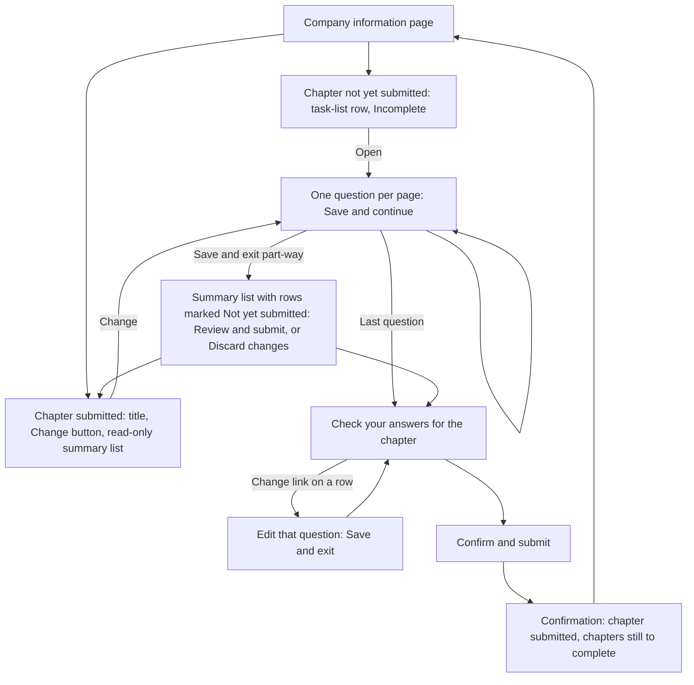

Save and exit on any question keeps the answers as a draft and returns to the Company information page; Cancel and exit discards that page's unsaved edits. Nothing changes until Confirm and submit on the chapter's Check your answers. Submitting one chapter leaves drafts in other chapters as they are.

## Onboard a new product

Dashboard, then Product management, then Product onboarding. Each product has its own form. The sample form is Respira CBT, at `/supplier-portal/products/onboard/respira-cbt`. Answers save as you go. Submit stays unavailable until every task is completed.

The form has four sections and seven tasks. Each task is a run of one-question-per-page screens, and some questions only appear depending on earlier answers in the same task (see "Product onboarding question routes" below).

1. Product details (A2 product name, A3 version number, A4 type of product, with a "Give details" box on the same page when Other is chosen)
2. Value proposition (Section B, not scored)
3. Assessed standards: Clinical safety (C1), Data protection (C2), Technical security (C3), Interoperability (C4)
4. Key principles for success: Usability and accessibility (Section D)

Once the product name (A2) is answered, later questions, hints and page titles say the product's name instead of "your product" or "the product" (for example, "Does Respira CBT qualify as software or AI as a medical device?").

Each Assessed standards task opens with an information page before its first question. It has a heading, guidance text and links, and a Continue button. It has no answer, so it does not appear on Check your answers and does not hold up the task being completed:

- Clinical safety: why clinical safety must be established, DCB0129 (manufacturers) and DCB0160 (deploying organisations), and reporting safety concerns through the MHRA Yellow Card scheme and the Learn from patient safety events service
- Data protection: collecting, storing and using personal data in line with UK GDPR, for the version of the product being assessed
- Technical security: industry best practice security standards, and contractual arrangements for incidents and disaster recovery
- Interoperability: exchanging data with other systems, following the GDS Open API Best Practices, and reflecting NHS and social care standards

Some upload questions offer a "can't provide" link: the clinical risk management system, Clinical Safety Case Report and Hazard Log (C1), ICO registration evidence and the DPIA (C2), and the Cyber Essentials certificate and penetration test summary (C3). Choosing it records "Not provided" and moves on to the next question on the route.

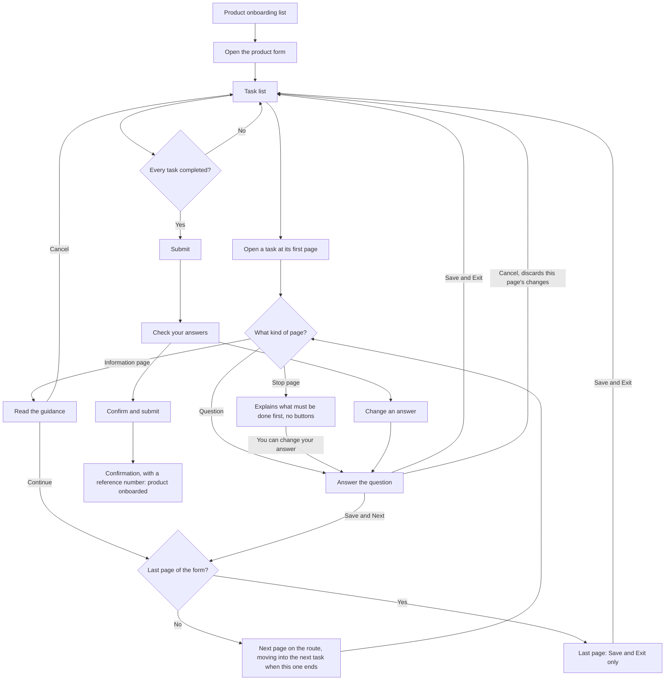

Save and Next saves the answer and goes to the next page on the supplier's route. At the end of a task it carries straight on into the first page of the next task, across sections, so a supplier can go through the whole form without returning to the task list. The last page of the form (D1.5, or D1.4 when the product is not a web or mobile application) has no Save and Next.

Save and Exit saves and returns to the task list. A task is marked Completed once every question on its route has an answer, whichever button was used; otherwise it stays incomplete and the supplier can come back to it. Cancel discards changes on the current page and returns to the task list. Information pages have only Continue and Cancel. Stop pages (C1.2.2 "No" and C2.1 "No") have no buttons; instead they offer "You can change your answer" (back to the question) and "Get support" from the HealthStore team.

The Submit button on the task list stays unavailable until every task is Completed and leads to Check your answers. Confirm and submit onboards the product straight away and the form status becomes Submitted. After that the product is kept up to date from Manage products.

Two prototype shortcuts help with testing. Question pages have a "Fill with sample" link that enters a sample answer. The task list has a "Mark all as complete" link that fills any unanswered questions with sample answers and marks every task Completed, so Submit can be tried straight away.

### Product onboarding question routes

Save and next only visits the questions on the supplier's route. Questions that are skipped are left out of the Completed check and of Check your answers. Changing an earlier answer can bring a skipped question back; its previous answer, if any, is kept. "Provided / Not provided" questions are followed by a separate upload (or text) page when the answer is Provided.

#### Section A: Product details

No branching. Choosing Other on A4 shows a "Give details" box on the same page.

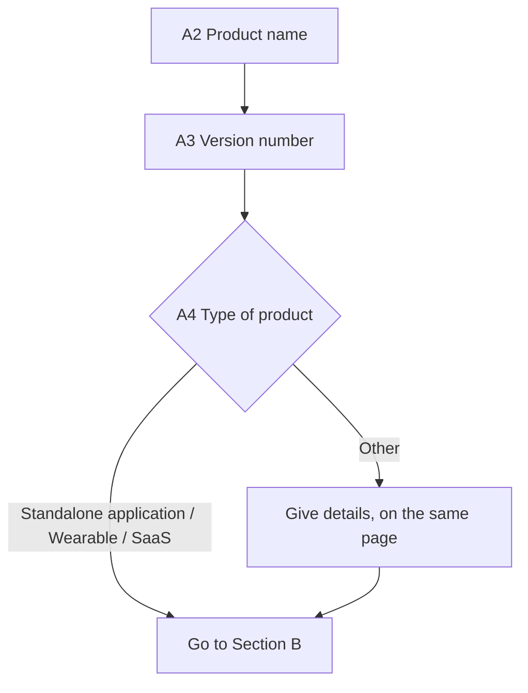

#### Section B: Value proposition

No branching apart from the B4 upload.

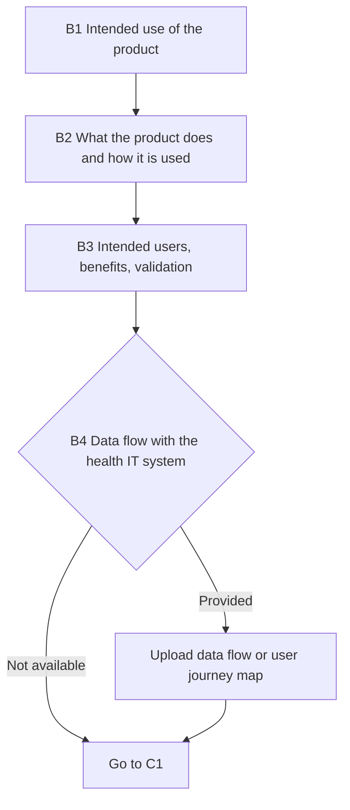

#### C1: Clinical safety (DCB0129)

An interstitial page on DCB0129 / DCB0160 / MHRA reporting is shown before any C1 question.

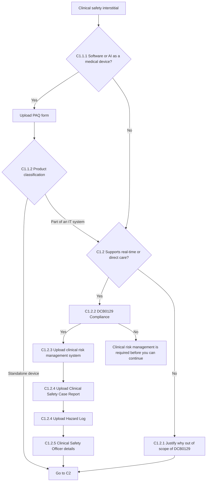

#### C2: Data protection (UK GDPR)

An interstitial page on UK GDPR compliance is shown before any C2 question. C2.2.1 to C2.2.6 are asked only when the product processes personal data.

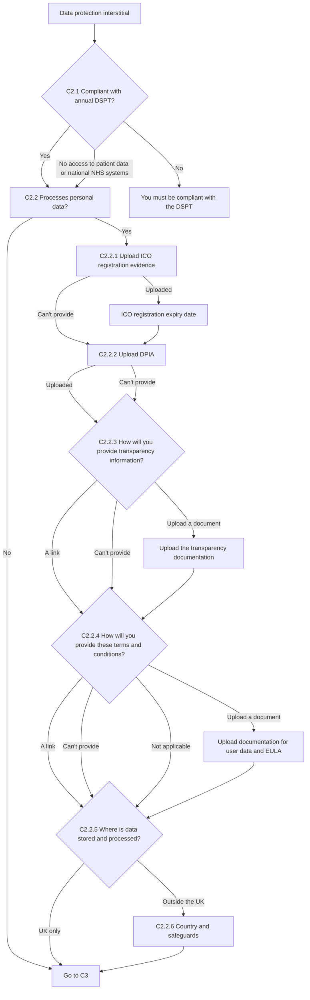

#### C3: Technical security

An interstitial page on security standards is shown before any C3 question.

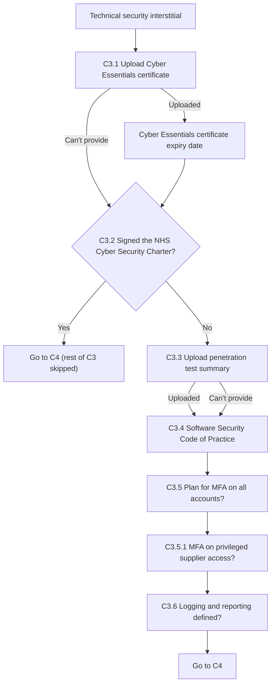

#### C4: Interoperability

An interstitial page on data exchange and Open API practice is shown before any C4 question.

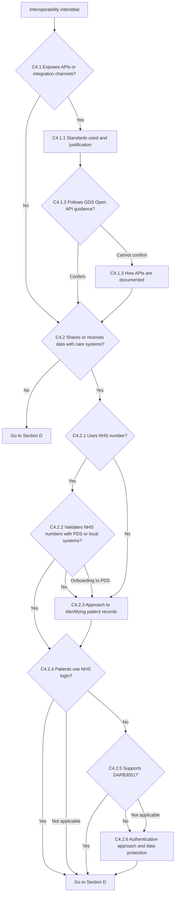

#### Section D: Usability and accessibility

D1.4 first asks whether the product is a web or mobile application. No ends Section D; Yes asks which platforms are supported, then continues to D1.4.1.

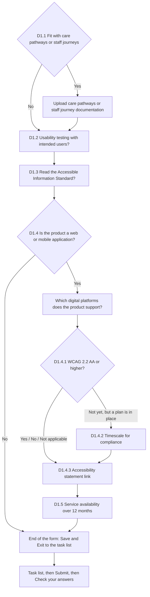

## Update an existing product

Dashboard, then Product management, then Manage products. The sample product is Respira CBT, which starts as Up to date. A supplier can change the product summary, who it is for, the support email, and the assurance documents.

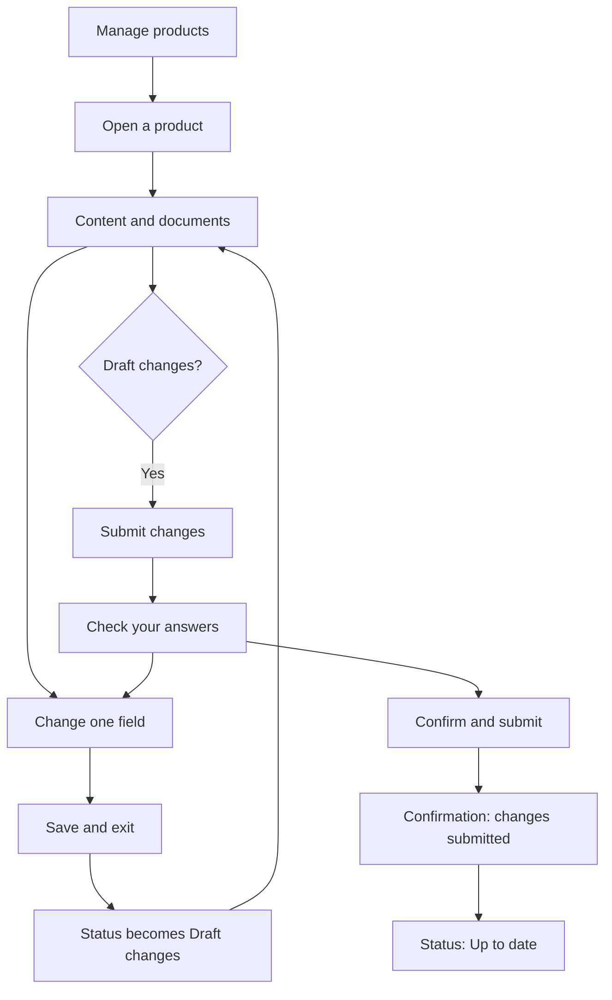

Draft changes are not used until they are submitted. Submit changes only appears once there are draft changes. Check your answers lists only the fields that differ from the current version. Confirming makes them the current version straight away and the status returns to Up to date.

## Publish or update a store page

Dashboard, then Published pages. There is a page for each product and one supplier page. The supplier edits the public wording on one page, with Submit changes, Save and exit, and Cancel and exit. Content that came from onboarding is shown on the page and cannot be changed here. Preview changes opens the store page in a new window.

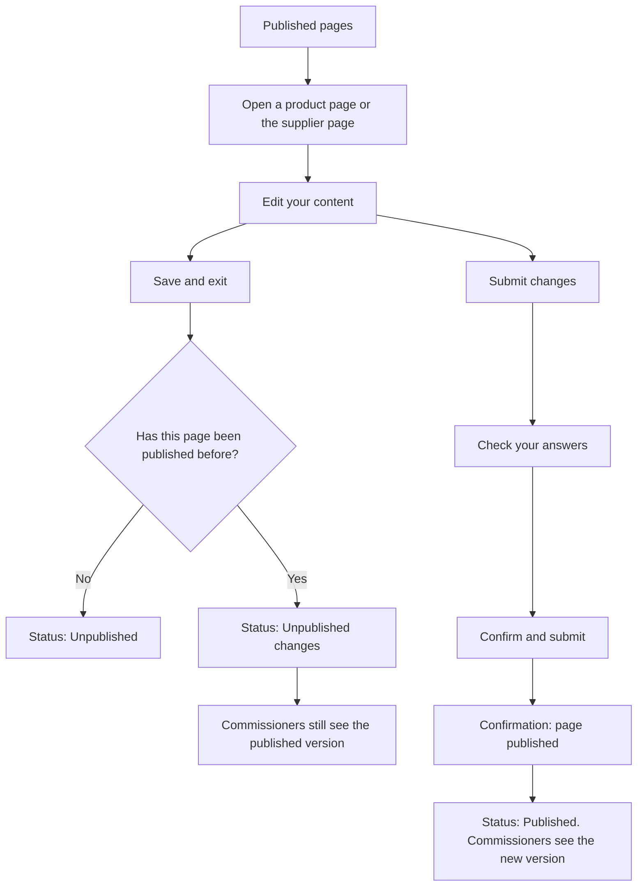

A page that has never been published starts as Unpublished, so commissioners cannot see it, and it is listed under Needs your attention. Submitting publishes it straight away. Later saves become Unpublished changes, and the live page stays as it was until the new version is submitted.
